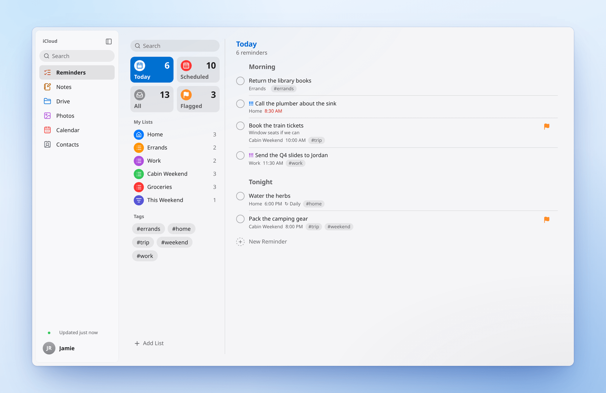
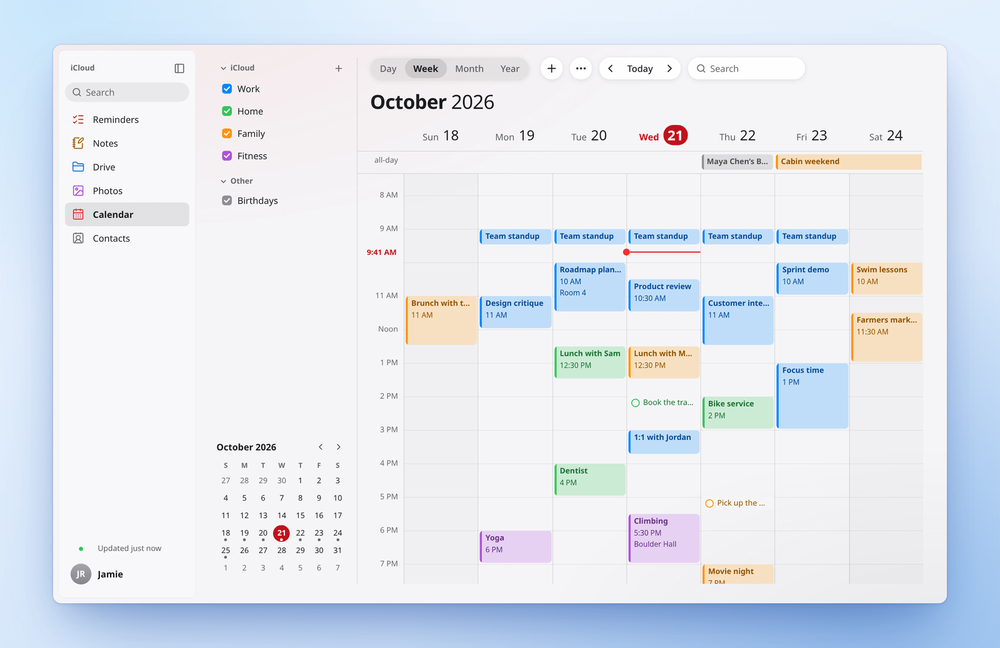
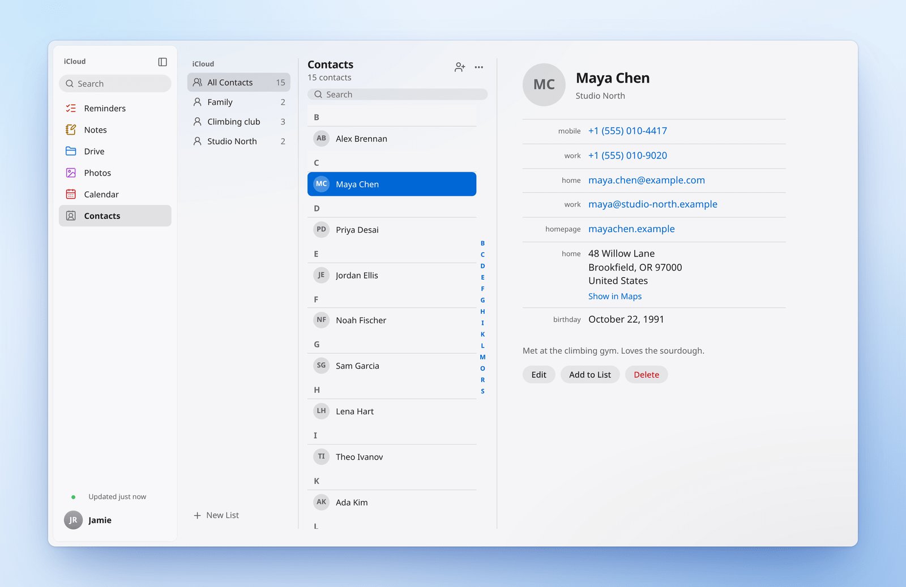
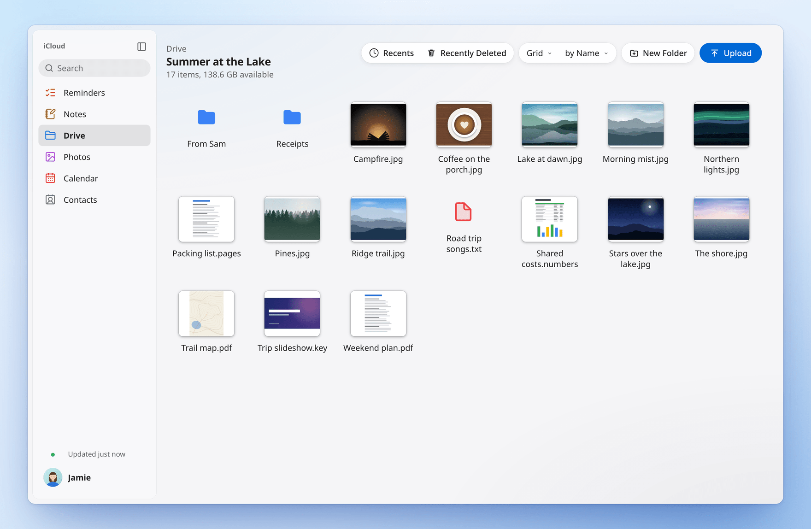
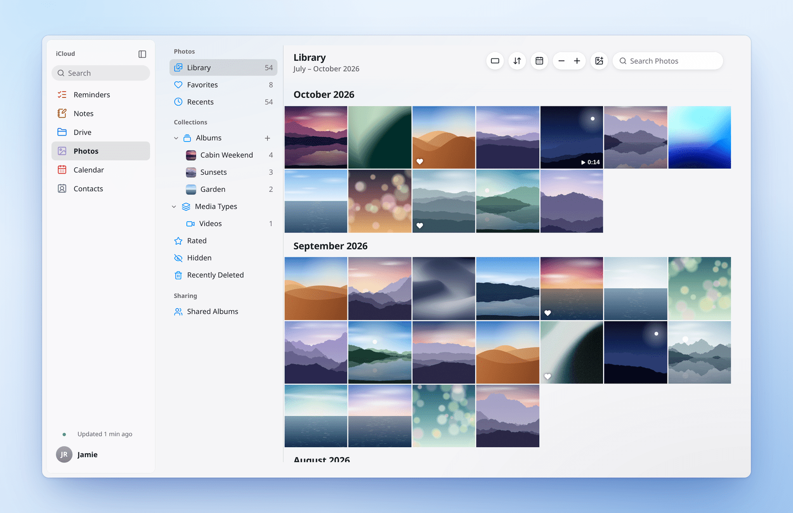
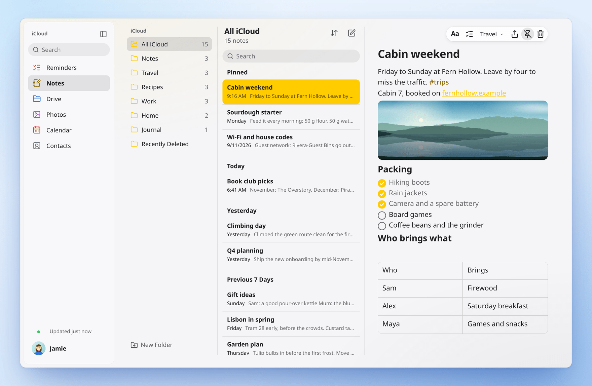

<div align="center">


# Skykeep

**Your iCloud, at home on Linux and Windows.**

Notes, Reminders, Calendar, Contacts, Drive and Photos as fast desktop apps that stay in sync with your iPhone.

[](LICENSE)
[](#install)
[](#privacy)
[](#contributing)
<!-- Dynamic badges: enable once the repository is public.
[](https://github.com/YashwanthKamireddi/Skykeep/releases)
[](https://github.com/YashwanthKamireddi/Skykeep/actions/workflows/release.yml)
[](https://github.com/YashwanthKamireddi/Skykeep/stargazers)
[](https://aur.archlinux.org/packages/skykeep-git)
[](https://flathub.org/apps/io.github.yashwanthkamireddi.Skykeep)
-->

[Install](#install) · [First run](#first-run) · [Features](#features) · [Privacy](#privacy) · [FAQ](#faq) · [Contributing](#contributing)

<br>


</div>

## Six apps, one sign-in

<table>
  <tr>
    <td width="50%" align="center">
      <picture>
        <source media="(prefers-color-scheme: dark)" srcset="docs/media/reminders-dark.png">
        
      </picture>
      <b>Reminders</b>
    </td>
    <td width="50%" align="center">
      <picture>
        <source media="(prefers-color-scheme: dark)" srcset="docs/media/calendar-dark.png">
        
      </picture>
      <b>Calendar</b>
    </td>
  </tr>
  <tr>
    <td width="50%" align="center">
      <picture>
        <source media="(prefers-color-scheme: dark)" srcset="docs/media/contacts-dark.png">
        
      </picture>
      <b>Contacts</b>
    </td>
    <td width="50%" align="center">
      <picture>
        <source media="(prefers-color-scheme: dark)" srcset="docs/media/drive-dark.png">
        
      </picture>
      <b>iCloud Drive</b>
    </td>
  </tr>
  <tr>
    <td width="50%" align="center">
      <picture>
        <source media="(prefers-color-scheme: dark)" srcset="docs/media/photos-dark.png">
        
      </picture>
      <b>Photos</b>
    </td>
    <td width="50%" align="center">
      <picture>
        <source media="(prefers-color-scheme: dark)" srcset="docs/media/notes-dark.png">
        
      </picture>
      <b>Notes</b>
    </td>
  </tr>
</table>

## Features

| App | What you can do | Coming |
|---|---|---|
| **Notes** | Write with headings, styles, lists and checklists. See pictures, scans, PDFs and tables in place. Folders, pinned notes, search and Recently Deleted. Edits from your phone merge with yours. | Adding attachments, editing tables |
| **Reminders** | Lists with colours and icons, Today, Scheduled, Flagged and your smart lists. Subtasks, due dates, repeats, flags and priorities. Alerts with **Complete** and **Snooze**. | Editing tags, links, early alerts and sections |
| **Calendar** | Day, Week, Month and Year. Drag to create, move and resize. Repeating events, alerts, time zones, birthdays and holidays. Subscribe to any `webcal://` calendar and open `.ics` files. | |
| **Contacts** | Every field, with Apple's labels. Lists, My Card, find and merge duplicates. Import vCard or a Google or Outlook CSV; export vCard. | |
| **iCloud Drive** | List or grid with thumbnails. Upload files and folders, rename, move, duplicate and preview with Space. On Linux, iCloud Drive is also a real folder in your file manager. | |
| **Photos** | Your library by month, albums and shared albums, Favourites and Videos. A viewer for Live Photos and videos, slideshow, upload and original-quality download. | |
| **Everywhere** | Search across every app. Quick capture for a note or reminder. Results in GNOME and KDE search, a tray icon, light and dark. **Export Everything** to Markdown, iCalendar, vCard and your original files. | |

## Install

Download Skykeep from the [Releases page](https://github.com/YashwanthKamireddi/Skykeep/releases). Each release comes with SHA-256 checksums.

### Windows 10 and 11

Run `Skykeep_<version>_x64-setup.exe`. It installs just for you, with no administrator password.

If Windows shows **Windows protected your PC**, choose **More info**, then **Run anyway**.

### Linux

Run the line for your system from the folder you downloaded to.

**Ubuntu, Debian, Linux Mint**

```sh
sudo apt install ./Skykeep_*_amd64.deb
```

**Fedora**

```sh
sudo dnf install ./Skykeep-*.x86_64.rpm
```

**Arch, CachyOS, EndeavourOS, Manjaro** <sub>coming to the AUR</sub>

```sh
paru -S skykeep-git    # or: yay -S skykeep-git
```

**Any other distribution**

```sh
chmod +x Skykeep_*_amd64.AppImage && ./Skykeep_*_amd64.AppImage
```

<details>
<summary><b>Other ways to install</b></summary>

**Windows installer package.** The `.msi` on the Releases page installs the same app.

**Flatpak** <sub>coming to Flathub</sub>. The manifest is in [`packaging/flatpak`](packaging/flatpak). In the Flatpak, iCloud Drive and Photos open inside the app.

```sh
flatpak install flathub io.github.yashwanthkamireddi.Skykeep
```

**Arch, from a checkout.** Builds and installs Skykeep from the source you cloned:

```sh
git clone https://github.com/YashwanthKamireddi/Skykeep.git
cd Skykeep/packaging/arch && makepkg -si
```

**iCloud Drive and Photos as folders** in your file manager need `fuse3` (on Arch: `sudo pacman -S fuse3`).

**From source:** see [Contributing](#contributing).
</details>

## First run

1. **Sign in** with your Apple Account and password.
2. **Approve** the sign-in on your iPhone or another Apple device, then type the six-digit code it shows. No prompt? Choose **Didn't get a code?** to get one by text message.
3. **You're set.** Each app fills in as your library arrives. After that, everything opens instantly.

Your password stays on this computer: Skykeep proves it to Apple without sending it, and keeps your sign-in in your system keyring. [How Skykeep handles your data](SECURITY.md).

On Linux, your desktop may ask you to unlock its keyring the first time. That's where Skykeep keeps your sign-in.

## Privacy

- **Local-first.** Your library lives on your computer, so every app opens instantly, even offline.
- **Your sign-in stays in your system keyring:** Secret Service (GNOME Keyring or KWallet) on Linux, Credential Manager on Windows. Two-factor sign-in is Apple's own.
- **Talks only to Apple,** plus any calendars you subscribe to. No Skykeep account, no Skykeep server, no telemetry.
- **Independent.** Skykeep is an open-source project, not affiliated with or endorsed by Apple.

The details, with the code behind each one, are in [SECURITY.md](SECURITY.md).

<!-- Performance: add this table once release builds are measured.
| | Linux | Windows |
|---|---|---|
| Launch to a usable window | | |
| Open a note from the list | | |
| A change on iPhone shown here | | |
| Memory with all six apps open | | |
| Download size | | |
-->

## FAQ

<details>
<summary><b>Is Skykeep made by Apple?</b></summary>

No. It's an independent, open-source app that works with iCloud. Apple, iCloud and iPhone are trademarks of Apple Inc.
</details>

<details>
<summary><b>Why does it need my Apple Account password?</b></summary>

Notes, Reminders, Drive and Photos open only to a full sign-in with two-factor, the same one icloud.com uses. An app-specific password reaches only mail, contacts and calendars. Skykeep never sends your password, not even to Apple: it proves it with Apple's own SRP sign-in.
</details>

<details>
<summary><b>Which Apple Accounts work?</b></summary>

Personal Apple Accounts. Managed Apple Accounts from a school or workplace aren't supported yet.
</details>

<details>
<summary><b>Does it work offline?</b></summary>

Yes. Everything you've synced is on your disk. Notes, reminders, events and contacts can be edited offline and sync when you reconnect.
</details>

<details>
<summary><b>How fast do changes from my iPhone appear?</b></summary>

Notes and Reminders arrive over Apple's push channel, usually in about a second. Calendar and Contacts are checked every few seconds while you're using Skykeep. Your own edits show the moment you make them.
</details>

<details>
<summary><b>I use Advanced Data Protection. Will it work?</b></summary>

Yes, with **Access iCloud Data on the Web** turned on: on your iPhone, Settings → your name → iCloud. Skykeep tells you when it's needed.
</details>

<details>
<summary><b>Can I take my data with me?</b></summary>

Any time. Settings → Export Everything saves your notes as Markdown, events as iCalendar, contacts as vCard, and your files as they are.
</details>

<details>
<summary><b>Which systems does it run on?</b></summary>

Windows 10 and 11, and any Linux desktop with WebKitGTK 4.1 and a keyring (GNOME Keyring or KWallet), on Wayland or X11. The `.deb` is built on Ubuntu 24.04 and the `.rpm` is tested on Fedora 41.
</details>

## Contributing

Bug reports, packaging recipes, design ideas and code are all welcome. Start with [CONTRIBUTING.md](.github/CONTRIBUTING.md) for setup and the checks, and run `./check.sh` before a pull request.

```sh
git clone https://github.com/YashwanthKamireddi/Skykeep.git
cd Skykeep && npm ci && ./run.sh
```

Found a security issue? Please report it privately, as described in [SECURITY.md](SECURITY.md).

## License

[GPL-3.0](LICENSE). Not affiliated with Apple Inc.
