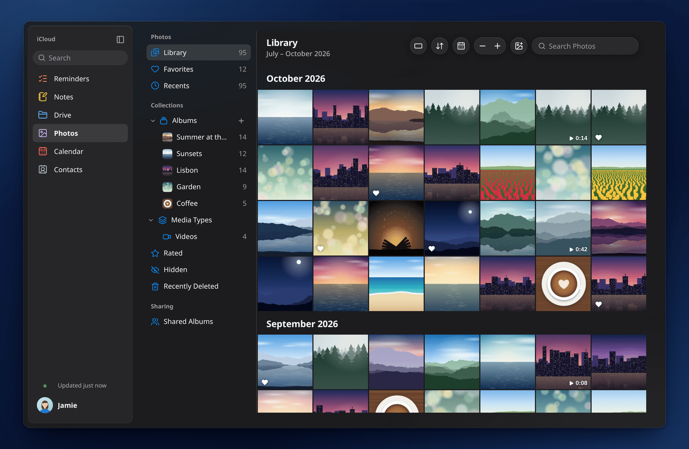
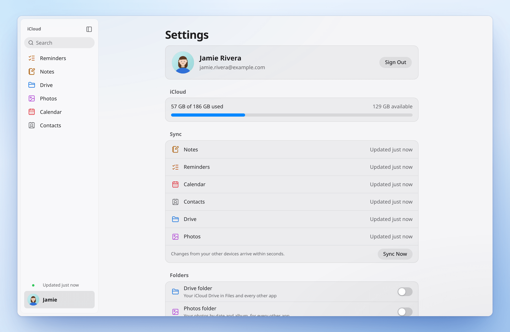
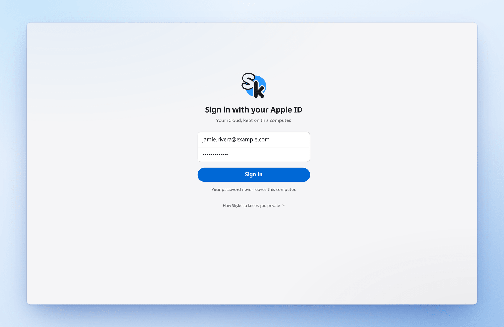
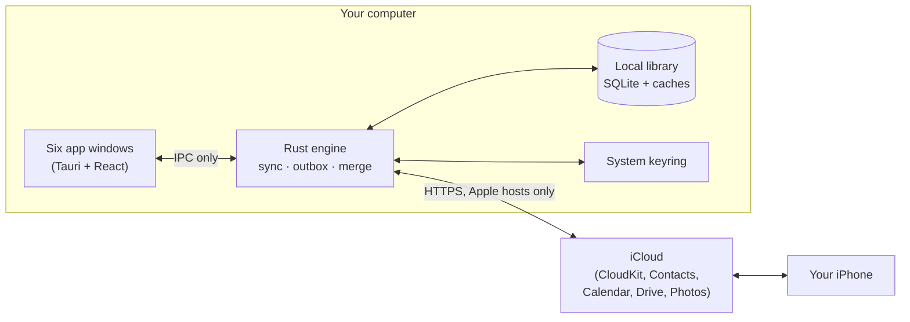

<div align="center">

<picture>
  <!-- The mark sits on a transparent background and reads on light and dark alike.
       To use a dedicated dark variant later, point the first srcset at docs/media/logo-dark.png. -->
  <source media="(prefers-color-scheme: dark)" srcset="packaging/icons/skykeep-1024.png">
  <source media="(prefers-color-scheme: light)" srcset="packaging/icons/skykeep-1024.png">
  
</picture>

# Skykeep

**Native iCloud apps for Linux and Windows.**

Your Notes, Reminders, Calendar, Contacts, iCloud Drive and Photos as fast, native apps on your own computer.<br>
Instant. Offline. Private. Open source.

[](LICENSE)
[](https://github.com/YashwanthKamireddi/Skykeep/releases)
[](https://github.com/YashwanthKamireddi/Skykeep/actions/workflows/release.yml)
[](https://github.com/YashwanthKamireddi/Skykeep/actions/workflows/windows.yml)
<br>
[-4a5568)](#install)
[](https://www.rust-lang.org)
[](https://tauri.app)
[](https://github.com/YashwanthKamireddi/Skykeep/stargazers)
<!-- Enable once published:
[](https://aur.archlinux.org/packages/skykeep-git)
[](https://flathub.org/apps/io.github.yashwanthkamireddi.Skykeep)
-->

[**Install**](#install) · [**Features**](#features) · [**Privacy**](#privacy-by-design) · [**FAQ**](#faq) · [**Build from source**](#build-from-source) · [**Contributing**](#contributing) · [**Roadmap**](#roadmap)

</div>

<br>

<div align="center">
  <!-- Hero: an edit on an iPhone shows up in Skykeep about a second later. See docs/media/README.md. -->
  
</div>

<br>

<table>
  <tr>
    <td width="50%">
      <picture>
        <source media="(prefers-color-scheme: dark)" srcset="docs/media/notes-dark.png">
        
      </picture>
      <p align="center"><b>Notes</b></p>
    </td>
    <td width="50%">
      <picture>
        <source media="(prefers-color-scheme: dark)" srcset="docs/media/reminders-dark.png">
        
      </picture>
      <p align="center"><b>Reminders</b></p>
    </td>
  </tr>
  <tr>
    <td width="50%">
      <picture>
        <source media="(prefers-color-scheme: dark)" srcset="docs/media/calendar-dark.png">
        
      </picture>
      <p align="center"><b>Calendar</b></p>
    </td>
    <td width="50%">
      <picture>
        <source media="(prefers-color-scheme: dark)" srcset="docs/media/drive-dark.png">
        
      </picture>
      <p align="center"><b>iCloud Drive</b></p>
    </td>
  </tr>
</table>

<details>
<summary><b>More screenshots</b>: Contacts, Photos, Settings, sign-in</summary>
<br>

| | |
|---|---|
|  |  |
| **Contacts** | **Photos** (preview) |
|  |  |
| **Settings**: your account, storage and sync | **Sign-in**: Apple's own sign-in and two-factor code |

</details>

---

## Why Skykeep

Your iPhone keeps your life in iCloud: the shopping list, the meeting notes, the birthdays, the files. Apple makes iCloud apps for its own devices, so on a Linux or Windows computer you've had a browser tab and a lot of waiting.

**Skykeep brings your iCloud home.** It keeps a copy of your iCloud on your own computer, so every screen opens instantly, works without a connection, and stays in sync with your iPhone in both directions. The engine is written in Rust; it talks only to Apple; and the code is open for anyone to read.

> *Sky* is the cloud, where your iCloud lives. A *keep* is the strongest tower of a castle, where precious things are kept. **Skykeep: your cloud, kept safe on your own computer.**

## Highlights

|   |   |
|---|---|
| **Six apps, one engine** | Notes, Reminders, Calendar, Contacts, Drive and Photos. Each opens as its own app; all share one sign-in and one sync. |
| **Instant** | Your library lives on your disk. Screens open immediately, with no loading from the internet. |
| **Works offline** | Read and edit without a connection. Changes are sent when you're back online. |
| **Two-way sync** | Notes and Reminders arrive over Apple's push channel in about a second. Calendar and Contacts check for changes every few seconds while a window is open. |
| **Private by design** | Your password never leaves your computer. No Skykeep account, no Skykeep server, no telemetry. The network layer can reach only Apple. |
| **At home on your desktop** | Light and dark mode, system notifications with action buttons, a tray icon, quick capture, results in GNOME and KDE search, and `.ics` / `.vcf` files opened straight into Calendar and Contacts. |
| **Your data, exportable** | Export Everything writes your whole library to Markdown, iCalendar, vCard, CSV and the original files, any time, offline. |

## Features

<details open>
<summary><b>Notes</b></summary>
<br>

- Rich text: titles, headings, monospaced text, bold, italic, underline, strikethrough, and colours set on your phone.
- Bulleted, dashed, numbered lists and checklists, typed as on the iPhone (`- `, `* `, `1. `, `[ ] `).
- Pictures, drawings, scans, PDFs, recordings and files shown in place and opened in your own apps.
- Tables shown as grids and kept up to date as they change on your phone.
- Folders (new, rename, nest, delete), pinned notes, Recently Deleted and Recover.
- Search within a folder or across every note.
- Edits made on your phone at the same moment are **merged, not overwritten**.
- Markdown export.

*Coming soon:* editing tables, adding attachments, and opening locked notes.
</details>

<details>
<summary><b>Reminders</b></summary>
<br>

- Lists with Apple's colours and glyphs, and groups of lists.
- Today, Scheduled, Flagged and All, plus your smart lists.
- Subtasks (Tab), due dates and all-day dates, repeating reminders, flags and priorities.
- Alerts that ring on this computer, with **Complete** and **Snooze** buttons.
- Drag to reorder; completing a repeating reminder works the way your phone does.
- Tags and sections are shown.

*Coming soon:* editing tags and sections.
</details>

<details>
<summary><b>Calendar</b></summary>
<br>

- Day, Week, Month and Year views.
- Drag or double-click to create; drag to move and resize; nudge with the keyboard.
- Repeating events, with This Event, All Future Events and All Events.
- Alerts, time zones, and your reminders on the schedule in their list's colour.
- Birthdays and holidays.
- Create, rename, recolour and delete calendars.
- Subscribe to any public calendar by its `webcal://` or `https://` address.
- Open `.ics` files straight into an import sheet.

*Later:* invitations and RSVP.
</details>

<details>
<summary><b>Contacts</b></summary>
<br>

- Every field: phones, emails, links, addresses, birthdays, notes, with Apple's own labels, and structured addresses.
- Lists in a sidebar; add people by menu or by dragging.
- Select several to add, remove, export or delete together.
- Import from vCard, or from a CSV exported by Google Contacts or Outlook. Export to vCard.
- My Card.
</details>

<details>
<summary><b>iCloud Drive</b></summary>
<br>

- Browse in a list or grid with Apple's thumbnails; sort; Recents.
- Upload files or whole folders by button or drag and drop, with per-file progress and cancel.
- Download, rename, duplicate, Get Info, move by dialog or by dragging onto a folder.
- Quick preview with Space; keep files on this computer for offline use.
- Recently Deleted with Recover and Delete Now; your storage at a glance.
- **On Linux, iCloud Drive as a real folder** in your file manager (`~/iCloud Drive`, via FUSE).
</details>

<details>
<summary><b>Photos</b> <sub>(preview)</sub></summary>
<br>

> [!NOTE]
> Photos is a **preview**: it is built and tested, and is waiting on testing against a large real-world library before it leaves preview.

- Your whole library, edge to edge and by month, with zoom.
- Favourites, Recents, Videos, Screenshots, Recently Deleted, your albums and shared albums.
- A viewer with arrow keys, details, Favourite, Live Photos and videos.
- Search, slideshow, upload, and download in original quality.
</details>

<details>
<summary><b>Across every app</b></summary>
<br>

- **Global search** across notes, reminders, events, contacts, files and photos.
- **Quick capture:** `skykeep --new note` or `skykeep --new reminder` opens a small capture window. Also in the launcher's right-click menu.
- **Desktop search:** results appear in GNOME Shell search and KRunner.
- **Tray icon** and system notifications with sounds and action buttons.
- **Settings:** your account, iCloud storage, when each app last synced (with Sync Now), Automatic / Light / Dark, and alert switches.
- **Accessibility:** Reduce Transparency and Increase Contrast are honoured, and every app is built to be driven from the keyboard.
</details>

## Privacy by design

Skykeep asks for your Apple Account password, so it was built to deserve that trust, and it shows its work.

- **Your password never leaves your computer.** Sign-in uses Apple's own SRP flow: Skykeep proves it knows your password without sending it. Your session lives in your system keyring (Secret Service on Linux, Credential Manager on Windows).
- **It talks only to Apple, enforced in code.** Every network client is built by [`apple_only()`](crates/quince-auth/src/lib.rs), whose resolver refuses any host outside `apple.com`, `icloud.com` and `icloud-content.com`. A [test](crates/quince-auth/tests/apple_only.rs) holds it to that. The only other hosts it ever contacts are calendars you subscribe to yourself.
- **No Skykeep servers.** No account, no telemetry, no analytics, no crash reporting, no update check.
- **The window can't reach the network at all.** Its content security policy lets it talk only to Skykeep's own Rust core.
- **Your data stays yours.** Everything lives in your private data folder, and Export Everything hands it to you in open formats.

Read exactly what Skykeep talks to, what it keeps and where, in **[SECURITY.md](SECURITY.md)**.

## How it works



1. **Sign in once.** Apple's own sign-in and two-factor code. The session goes into your keyring.
2. **Your library comes home.** Each service syncs into a local SQLite library, and each screen fills as its service lands.
3. **Edits show instantly.** A change appears the moment you make it and goes into an outbox. It is sent to Apple when you're online, and put back with the reason if Apple ever refuses it.
4. **Changes flow back.** Notes and Reminders arrive over Apple's push channel; Calendar and Contacts are checked every few seconds, the same way icloud.com does.

## Install

> [!IMPORTANT]
> The first public release is on its way. Packages appear on the [Releases page](https://github.com/YashwanthKamireddi/Skykeep/releases) as they're published, each with SHA-256 checksums. Until then, [build from source](#build-from-source) in a few minutes.

| Platform | How | Status |
|---|---|---|
| **Arch, CachyOS, EndeavourOS, Manjaro** | `paru -S skykeep-git` or `yay -S skykeep-git` | AUR: coming soon |
| **Any distribution** | Flatpak from Flathub | Coming soon |
| **Debian, Ubuntu, Mint, Pop!_OS** | `.deb` from Releases | With the first release |
| **Fedora, openSUSE, RHEL** | `.rpm` from Releases | With the first release |
| **Any distribution, no install** | `.AppImage` from Releases | With the first release |
| **Windows 10 and 11** | `.exe` or `.msi` from Releases | **Beta** |

<details>
<summary><b>Arch Linux and derivatives</b></summary>
<br>

From the AUR (coming soon):

```sh
paru -S skykeep-git    # or: yay -S skykeep-git
```

Today, build the same package from a checkout:

```sh
git clone https://github.com/YashwanthKamireddi/Skykeep.git
cd Skykeep/packaging/arch
makepkg -si
```

Optional: install `fuse3` for iCloud Drive and Photos as folders in your file manager.
</details>

<details>
<summary><b>Debian / Ubuntu (.deb)</b></summary>
<br>

```sh
sudo apt install ./Skykeep_*_amd64.deb
```
</details>

<details>
<summary><b>Fedora / openSUSE (.rpm)</b></summary>
<br>

```sh
sudo dnf install ./Skykeep-*.x86_64.rpm       # Fedora
sudo zypper install ./Skykeep-*.x86_64.rpm    # openSUSE
```
</details>

<details>
<summary><b>AppImage</b></summary>
<br>

```sh
chmod +x Skykeep_*_amd64.AppImage
./Skykeep_*_amd64.AppImage
```

Needs WebKitGTK 4.1 and libsecret on the system, which most desktops already have.
</details>

<details>
<summary><b>Flatpak</b> (coming soon)</summary>
<br>

The Flathub manifest is in [`packaging/flatpak`](packaging/flatpak). Once it's live:

```sh
flatpak install flathub io.github.yashwanthkamireddi.Skykeep
```

In the Flatpak, iCloud Drive and Photos are available inside the app; the file-manager folders need the native packages.
</details>

<details>
<summary><b>Windows</b> (beta)</summary>
<br>

> [!NOTE]
> Windows builds are tested on every release in CI (the full test suite, every interface suite in Edge, and an install-and-launch smoke test), and they're labelled **beta** until they've been verified on more real Windows machines. Feedback is very welcome.

Download `Skykeep_*_x64-setup.exe` (per-user, no admin needed) or the `.msi` from [Releases](https://github.com/YashwanthKamireddi/Skykeep/releases) and run it. It registers `.ics` and `.vcf` files, and notifications come with Complete and Snooze buttons.

The iCloud Drive and Photos folders in Explorer are on the roadmap.
</details>

**Requirements on Linux:** `webkit2gtk-4.1` for the window and `libsecret` for the keyring (GNOME Keyring or KWallet). Packages pull them in for you.

## First run

1. **Open Skykeep** from your app menu. On Linux, each app (Notes, Reminders, Calendar, Contacts, Drive, Photos) also has its own launcher entry.
2. **Sign in** with your Apple Account, then enter the code shown on your iPhone. This is Apple's own two-factor flow.
3. **Watch your library arrive.** Each app fills as its data lands. After this first sync, everything opens instantly, even offline.
4. **Optional:** in Settings, turn on the iCloud Drive and iCloud Photos folders (Linux), choose your appearance, and set which alerts ring.

> [!TIP]
> Using **Advanced Data Protection**? Turn on **Access iCloud Data on the Web** on your iPhone: Settings → your name → iCloud → Access iCloud Data on the Web. Skykeep tells you if it's needed.

## Keyboard shortcuts

Skykeep follows the keys of Apple's own apps, with **Ctrl** in place of **⌘**.

<details>
<summary><b>Show all shortcuts</b></summary>
<br>

| Where | Keys | Action |
|---|---|---|
| Everywhere | `Ctrl` `R` / `F5` | Sync the app in front |
| Notes | `Ctrl` `N` | New note |
| | `Ctrl` `F` / `Ctrl` `Shift` `F` | Search this folder / all notes |
| | `↑` `↓` | Previous / next note |
| | `Ctrl` `Delete` | Delete note |
| | `Ctrl` `S` | Finish editing |
| Reminders | `Ctrl` `N` / `Ctrl` `Shift` `N` | New reminder / new list |
| | `Tab` / `Shift` `Tab` (or `Ctrl` `]` / `Ctrl` `[`) | Make a subtask / move it back out |
| | `Space` · `Return` | Tick · edit |
| | `Ctrl` `I` | Show details |
| | `Ctrl` `F` | Search |
| Calendar | `Ctrl` `1` – `4` | Day, Week, Month, Year |
| | `T` | Today |
| | `Ctrl` `Shift` `T` | Go to Date |
| | `←` `→` | Previous / next |
| | `Ctrl` `N` | New event |
| | `Ctrl` `D` · `Ctrl` `C` · `Ctrl` `V` | Duplicate · copy · paste event |
| | `Ctrl` `Alt` `↑↓←→` | Nudge the selected event |
| Contacts | `Ctrl` `N` · `Ctrl` `F` · `Ctrl` `A` | New contact · search · select all |
| Drive | `Return` / `Ctrl` `↓` | Open |
| | `Ctrl` `↑` | Enclosing folder |
| | `Space` | Quick preview |
| | `F2` · `Delete` | Rename · move to Recently Deleted |
| Photos | `←` `→` | Previous / next |
| | `.` or `F` | Favourite |
| | `I` · `Z` | Info · zoom to fit / full size |
| | `Ctrl` `+` `-` `0` | Zoom in / out / reset |
| | `Space` | Play a video or Live Photo |
| | `Esc` | Close the viewer |

</details>

## FAQ

<details>
<summary><b>Is Skykeep made by Apple?</b></summary>
<br>

No. Skykeep is an independent, open-source project. It is **not affiliated with, endorsed by, or sponsored by Apple Inc.** iCloud, iPhone and Apple are trademarks of Apple Inc., used here only to describe what Skykeep works with.
</details>

<details>
<summary><b>Is it safe to give Skykeep my Apple Account password?</b></summary>
<br>

Your password is used only on your computer, through Apple's SRP sign-in, which proves you know it without sending it. It's stored in your system keyring so a lapsed session can sign itself back in. Skykeep has no server and no account of its own, and its network layer refuses every host but Apple's. Every claim is in [SECURITY.md](SECURITY.md), with the code and tests that back it up.
</details>

<details>
<summary><b>I use Advanced Data Protection. Will it work?</b></summary>
<br>

Yes, with **Access iCloud Data on the Web** turned on (iPhone: Settings → your name → iCloud → Access iCloud Data on the Web). With that switch off, Apple lets no app outside your own devices read your iCloud data, Skykeep included. Skykeep explains this once and names the switch; it never asks you to turn Advanced Data Protection off.
</details>

<details>
<summary><b>Does it work offline?</b></summary>
<br>

Yes. Everything you've synced is on your disk. Read and edit freely; your changes wait in an outbox and are sent when you're back online. A small indicator shows anything still waiting.
</details>

<details>
<summary><b>How fast does a change on my iPhone show up?</b></summary>
<br>

Notes and Reminders arrive over Apple's push channel, typically in about a second. Calendar and Contacts are checked every few seconds while a window is open. Your own edits in Skykeep show the instant you make them.
</details>

<details>
<summary><b>What if I edit the same note on my phone and here at the same time?</b></summary>
<br>

Both edits are kept. Notes merges text the way Apple's apps do, so nothing either side typed is lost.
</details>

<details>
<summary><b>Which parts of iCloud aren't included?</b></summary>
<br>

Mail and Find My aren't part of Skykeep today. Health, Messages, Keychain, Home and Safari history are end-to-end encrypted by Apple and can't be read by any app outside your devices; Skykeep shows them as unavailable rather than leaving them out silently.
</details>

<details>
<summary><b>Which Linux desktops does it support?</b></summary>
<br>

Skykeep is built for any desktop with WebKitGTK 4.1 and a Secret Service keyring (GNOME Keyring or KWallet), on Wayland or X11. It's used daily on Hyprland, and GNOME and KDE Plasma also get Skykeep results in their desktop search. If something looks off on your desktop, please [open an issue](https://github.com/YashwanthKamireddi/Skykeep/issues/new/choose).
</details>

<details>
<summary><b>Can I get my data out?</b></summary>
<br>

Any time. Settings → Export Everything writes your whole library to a folder: notes as Markdown, events as iCalendar, contacts as vCard and CSV, and your files as they are. It works offline.
</details>

<details>
<summary><b>What happens if Apple changes something?</b></summary>
<br>

Skykeep uses the same services icloud.com uses. If Apple changes one, the affected screen may pause until an update catches up. Your local copy stays on your computer the whole time.
</details>

<details>
<summary><b>How do I sign out or remove my data?</b></summary>
<br>

Settings → Sign Out asks whether to keep a copy on this computer. Choose to remove it, and the library, its caches and its file-manager thumbnails are deleted.
</details>

## Build from source

<details open>
<summary><b>Linux</b></summary>
<br>

Prerequisites: Rust 1.85+ ([rustup](https://rustup.rs)), Node.js 22, and the system libraries.

```sh
# Debian / Ubuntu
sudo apt install libwebkit2gtk-4.1-dev libgtk-3-dev libayatana-appindicator3-dev \
  librsvg2-dev libsecret-1-dev libheif-dev libfuse3-dev pkg-config

# Arch
sudo pacman -S --needed webkit2gtk-4.1 gtk3 libsecret libheif libayatana-appindicator \
  gstreamer gst-plugins-base-libs fuse3 rust nodejs npm pkgconf

# Fedora
sudo dnf install webkit2gtk4.1-devel gtk3-devel libayatana-appindicator-gtk3-devel \
  librsvg2-devel libsecret-devel libheif-devel fuse3-devel pkgconf-pkg-config
```

Then:

```sh
git clone https://github.com/YashwanthKamireddi/Skykeep.git
cd Skykeep
npm ci
./run.sh                 # builds the interface and the app, then opens Skykeep
```

Packages (`.deb`, `.rpm`, `.AppImage` under `target/release/bundle/`):

```sh
npx tauri build
```
</details>

<details>
<summary><b>Windows</b></summary>
<br>

Install Rust, Node.js 22 and the [Tauri prerequisites](https://tauri.app/start/prerequisites/). HEIC support uses libheif from vcpkg:

```powershell
vcpkg install libheif:x64-windows-static-md
$env:VCPKG_ROOT = "<path to vcpkg>"
$env:VCPKGRS_TRIPLET = "x64-windows-static-md"
npm ci
npx tauri build
```

The exact steps CI uses are in [`.github/workflows/windows.yml`](.github/workflows/windows.yml).
</details>

## Architecture

Skykeep is one Rust engine with six app windows on top. The Rust side does all the talking to Apple; the interface is a React app rendered by the system's web engine (WebKitGTK on Linux, WebView2 on Windows), with no network access of its own.

<details>
<summary><b>Project layout</b></summary>
<br>

```text
crates/
  quince-auth/     Apple sign-in (SRP, two-factor), the session, the keyring,
                   and the apple_only() network allow-list
  quince-icloud/   iCloud services: CloudKit, Notes (topotext CRDT, tables),
                   Reminders, Calendar, Contacts, Drive, Photos, push channel
  quince-core/     The local library (SQLite), sync, outbox, search, export
  quince-vfs/      iCloud Drive and Photos as folders (FUSE, Linux)
  quince-media/    Picture decoding and thumbnails (including HEIC)
src-tauri/         The desktop app: windows, commands, alerts, tray, desktop search,
                   file import, migrations
src/               The interface (React + TypeScript)
  screens/         One folder or file per app, plus sign-in and Settings
  components/      The shared design system: Toast, Confirm, EmptyState, PaneTitle and more
  lib/             IPC, sync state, optimistic writes, theming
probe/             Live checks against a real iCloud account (run deliberately)
.uiverify/         Playwright interface suites, in Chromium and WebKit
packaging/         Arch, AUR, Flatpak, desktop entries, AppStream metadata, icons
```

The crates keep their original `quince-` prefix from before the project was named Skykeep.
</details>

<details>
<summary><b>Design principles</b></summary>
<br>

- **Instant, always.** Every write shows the moment it's made and rolls back with a reason if Apple refuses it. No screen waits on the network to redraw.
- **Calm and familiar.** Each app looks and behaves like the Apple app you already know, with that app's colour: Notes yellow, Calendar red, the rest blue.
- **Your content, never decorated.** Glass and translucency on the chrome only; content stays crisp.
- **Motion that never flickers.** Large layers open instantly; nothing animates that the engine can't draw cleanly on every desktop.
- **Simple for a beginner, fast for an expert, open for a developer.**
</details>

## Contributing

Contributions are welcome, from a typo fix to a new feature. Start with **[CONTRIBUTING.md](.github/CONTRIBUTING.md)** for setup, the checks, and commit style.

- **New here?** Pick a [good first issue](https://github.com/YashwanthKamireddi/Skykeep/labels/good%20first%20issue).
- **Ideas and questions:** [Discussions](https://github.com/YashwanthKamireddi/Skykeep/discussions).
- **Found a bug?** [Open an issue](https://github.com/YashwanthKamireddi/Skykeep/issues/new/choose).
- **Packagers:** Nix, Fedora COPR, Debian, winget and Snap recipes are especially welcome.
- **Designers:** UI contributions are welcome. Open a Discussion with a mockup or screenshot first, and read the design principles above.

Before a pull request, run `./check.sh`: formatting, Clippy, Rust tests, TypeScript, and the interface suites in a real browser engine.

## Roadmap

| | |
|---|---|
| **Shipped** | Six apps on one engine · two-way sync · offline outbox · Export Everything · desktop search · quick capture · `.ics` / `.vcf` import · the Apple-only network allow-list |
| **Now** | First public release · AUR and Flathub · Windows out of beta · Photos out of preview |
| **Next** | Editing Notes tables · adding attachments to notes · locked notes · editing reminder tags and sections · offline edits for events · merging duplicate contacts · an accessibility pass |
| **Later** | Drive and Photos folders in Windows Explorer · calendar invitations · sharing |

Have an idea? Share it in [Discussions](https://github.com/YashwanthKamireddi/Skykeep/discussions/categories/ideas).

## Security

Please report vulnerabilities privately through [GitHub's private vulnerability reporting](https://github.com/YashwanthKamireddi/Skykeep/security/advisories/new), not in a public issue. See [SECURITY.md](SECURITY.md) for what Skykeep talks to, what it stores, and where.

## Support the project

Skykeep is free and open source, built by one person. If it saves you a browser tab every day, a star helps others find it.
<!-- Enable once GitHub Sponsors is approved:
You can also [sponsor its development](https://github.com/sponsors/YashwanthKamireddi).
-->

## License

Skykeep is free software, licensed under the [GNU General Public License v3.0](LICENSE).

**Not affiliated with Apple.** Skykeep is an independent project that works with iCloud. Apple, iCloud, iPhone and related marks are trademarks of Apple Inc.

## Acknowledgements

Skykeep stands on excellent open-source work, including [Tauri](https://tauri.app), [Rust](https://www.rust-lang.org) and its ecosystem ([Tokio](https://tokio.rs), [reqwest](https://github.com/seanmonstar/reqwest), [rusqlite](https://github.com/rusqlite/rusqlite), [fuser](https://github.com/cberner/fuser), [libheif](https://github.com/strukturag/libheif)), [React](https://react.dev), [ProseMirror](https://prosemirror.net), [Lucide](https://lucide.dev), [Vite](https://vite.dev) and [Playwright](https://playwright.dev). Thank you to everyone who maintains them.

<div align="center">
<br>

<a href="https://star-history.com/#YashwanthKamireddi/Skykeep&Date">
  <picture>
    <source media="(prefers-color-scheme: dark)" srcset="https://api.star-history.com/svg?repos=YashwanthKamireddi/Skykeep&type=Date&theme=dark">
    
  </picture>
</a>

<br><br>

Made with care by [Yashwanth Kamireddi](https://github.com/YashwanthKamireddi).

</div>
