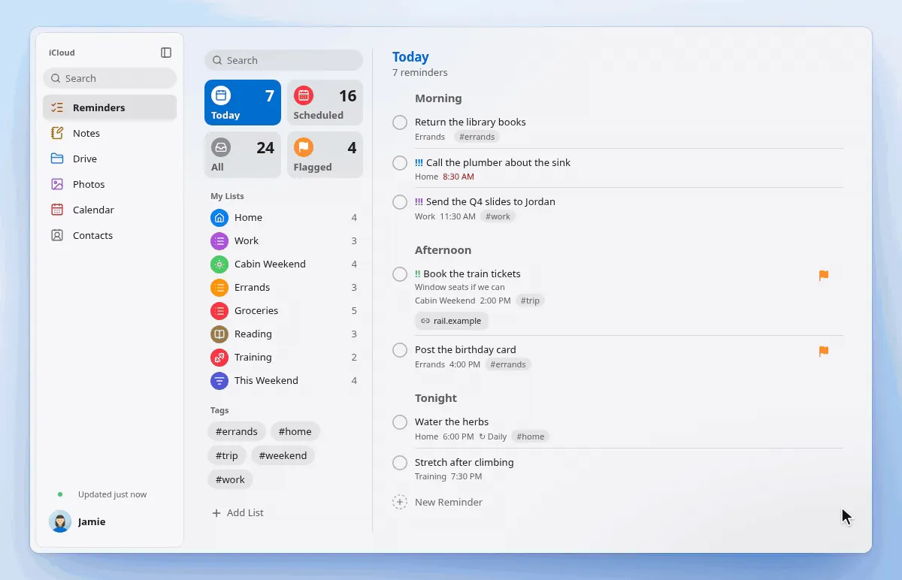
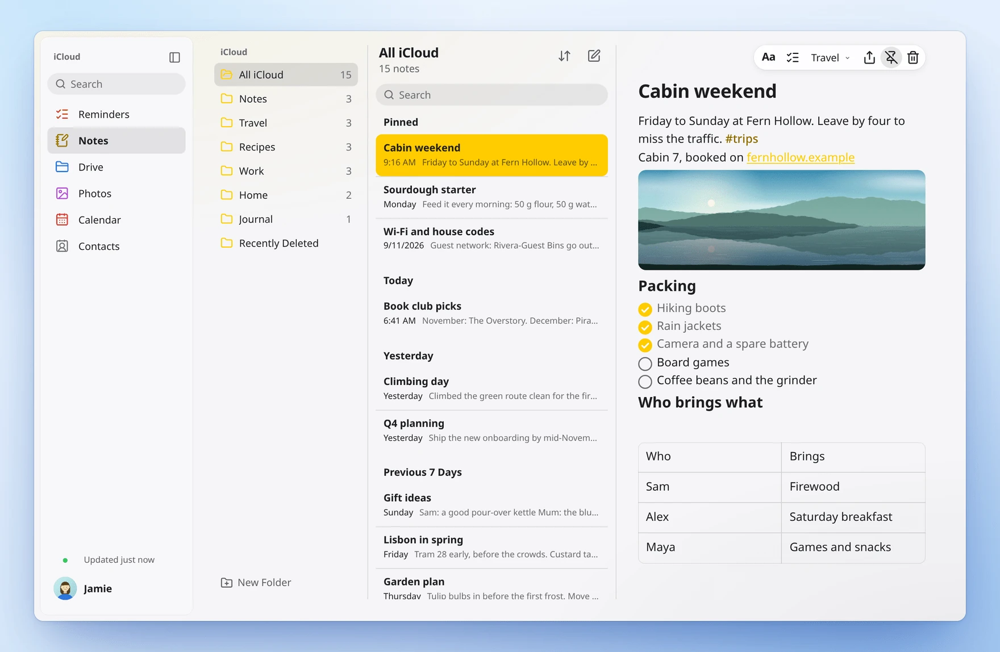
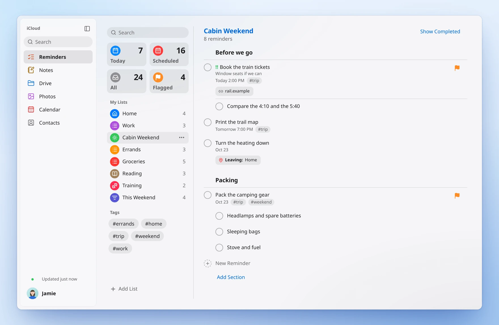
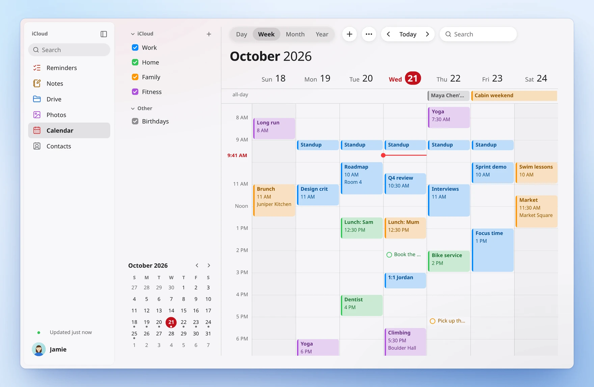
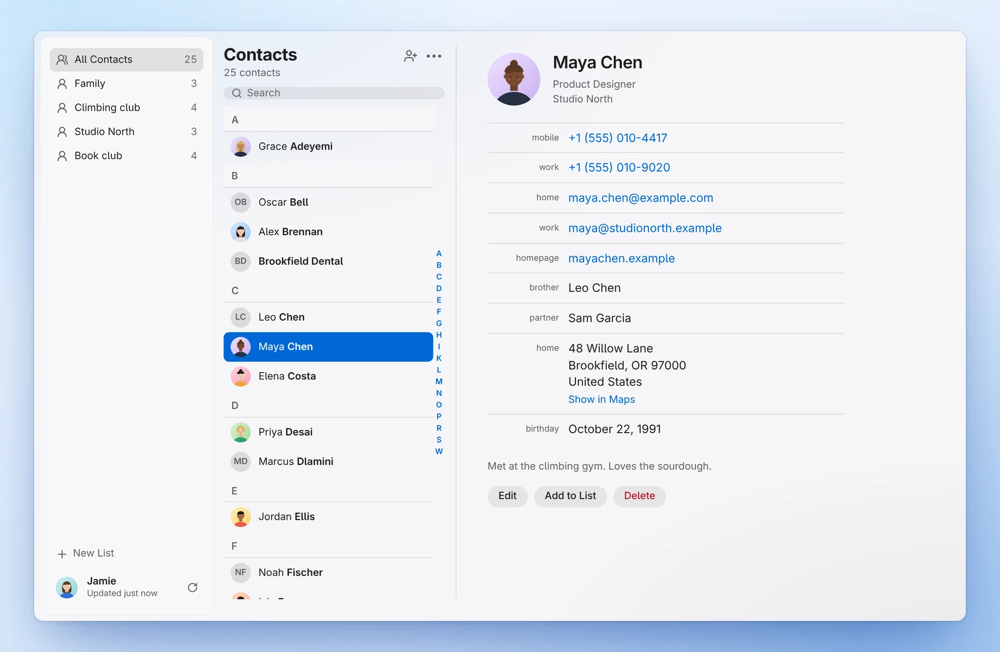
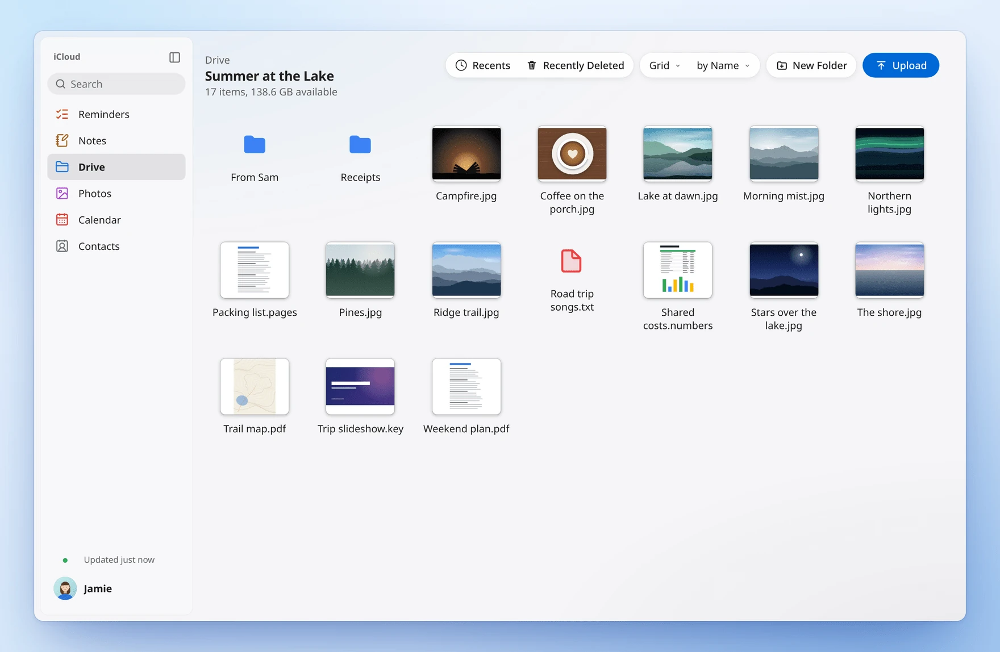
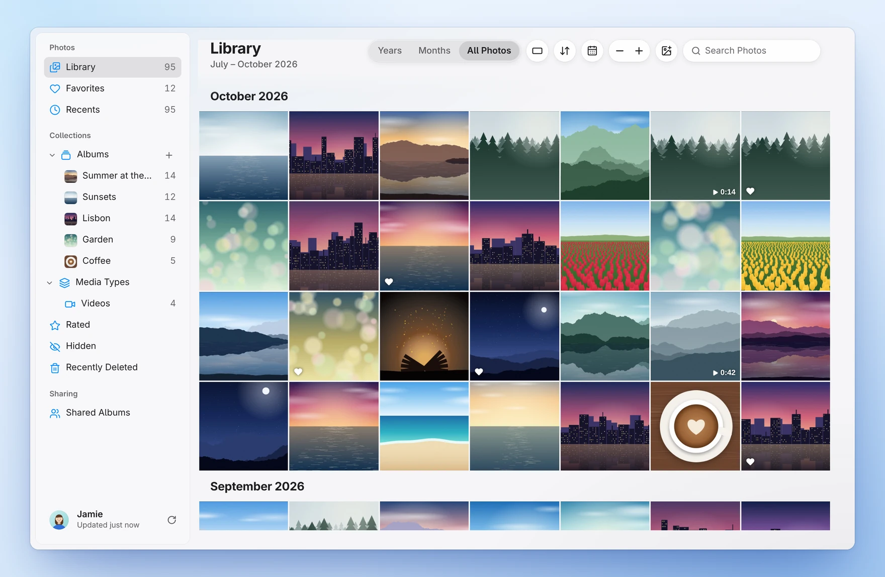

<div align="center">


# Skykeep

### Your iCloud, at home on Linux and Windows.

Notes, Reminders, Calendar, Contacts, iCloud Drive and Photos as fast desktop apps<br>that stay in sync with your iPhone. Free and open source.

<a href="https://github.com/YashwanthKamireddi/Skykeep/releases/latest"></a>&nbsp;
<a href="https://github.com/YashwanthKamireddi/Skykeep/releases/latest"></a>

<sub><b>Windows 10/11:</b> <code>x64-setup.exe</code> · <b>Ubuntu, Debian, Mint:</b> <code>.deb</code> · <b>Fedora, openSUSE:</b> <code>.rpm</code> · <b>Any other Linux:</b> <code>.AppImage</code> · <a href="#install">All install options</a></sub>

<sub>Works offline · No extra account · No analytics · GPL-3.0</sub>

<br>



[](LICENSE)
[](#install)
<!-- Dynamic badges: enable once the repository is public and v0.1.0 is published.
[](https://github.com/YashwanthKamireddi/Skykeep/releases/latest)
[](https://github.com/YashwanthKamireddi/Skykeep/releases)
Once live:
[](https://aur.archlinux.org/packages/skykeep-git)
[](https://flathub.org/apps/io.github.yashwanthkamireddi.Skykeep)
-->

[Why](#why-skykeep) · [Features](#features) · [Install](#install) · [Privacy](#privacy-and-security) · [How it works](#how-it-works) · [FAQ](#faq) · [Contributing](#contributing)

</div>

## Why Skykeep

Plenty of people love their iPhone and choose Linux or Windows for their computer. On those computers, iCloud lives in a browser tab. It needs a connection, there are no alerts, and iCloud Drive isn't in your file manager.

Skykeep brings your iCloud onto the computer itself. Your notes, reminders, calendar, contacts, files and photos are kept on your disk, so they open instantly and work offline. Change something on your iPhone and it shows up here. Change it here and it's on your iPhone.

- **Instant.** Your library lives on your computer. Every app opens right away, and your own edits show the moment you make them.
- **Live.** Notes and Reminders from your iPhone usually arrive in about a second, over Apple's push channel. Calendar and Contacts are checked every few seconds while you use Skykeep.
- **Offline.** On a train with no Wi-Fi? Keep writing. Notes, reminders, events and contacts sync when you're back online.
- **Real apps.** Six apps, one sign-in. Each has its own entry in your app launcher or Start menu, with alerts, a tray icon and quick capture.
- **Drive as a folder.** On Linux, iCloud Drive and Photos also appear as real folders in your file manager.
- **Yours.** Open source, no Skykeep account, no analytics. Export everything whenever you like.

## Features

<table>
  <tr>
    <td width="50%" align="center">
      <picture>
        <source media="(prefers-color-scheme: dark)" srcset="docs/media/notes-dark.webp">
        
      </picture>
      <b>Notes</b>
    </td>
    <td width="50%" align="center">
      <picture>
        <source media="(prefers-color-scheme: dark)" srcset="docs/media/reminders-dark.webp">
        
      </picture>
      <b>Reminders</b>
    </td>
  </tr>
  <tr>
    <td width="50%" align="center">
      <picture>
        <source media="(prefers-color-scheme: dark)" srcset="docs/media/calendar-dark.webp">
        
      </picture>
      <b>Calendar</b>
    </td>
    <td width="50%" align="center">
      <picture>
        <source media="(prefers-color-scheme: dark)" srcset="docs/media/contacts-dark.webp">
        
      </picture>
      <b>Contacts</b>
    </td>
  </tr>
  <tr>
    <td width="50%" align="center">
      <picture>
        <source media="(prefers-color-scheme: dark)" srcset="docs/media/drive-dark.webp">
        
      </picture>
      <b>iCloud Drive</b>
    </td>
    <td width="50%" align="center">
      <picture>
        <source media="(prefers-color-scheme: dark)" srcset="docs/media/photos-dark.webp">
        
      </picture>
      <b>Photos</b>
    </td>
  </tr>
</table>

### iCloud Notes

Headings, styles, lists and checklists. Add pictures and files, edit the text in tables, and see #tags, scans, PDFs and drawings in place. Folders, pinned notes, search and Recently Deleted. If you edit a note here while it changes on your phone, the two are merged, not overwritten.

### Apple Reminders

Lists with colours, icons and sections, plus Today, Scheduled, Flagged and your smart lists. Subtasks, due dates, repeats, flags, priorities, tags, links and early alerts. Type "Call Alex tomorrow at 5" and it's set for you. Desktop alerts with **Complete** and **Snooze**.

### iCloud Calendar

Day, Week, Month and Year. Drag to create, move and resize. Repeating events, alerts, time zones, birthdays and holidays. A **Join** button for video calls, the guest list, and your reminders on the schedule. Subscribe to any `webcal://` calendar and open `.ics` files.

### iCloud Contacts

Nearly every field, with Apple's labels, and contact photos. Lists, My Card, and finding and merging duplicates. Import vCard or a Google or Outlook CSV, and export vCard.

### iCloud Drive

List or grid with thumbnails. Upload files and folders, rename, move, duplicate, and preview with Space. On Linux, iCloud Drive is also a real folder in Files, Dolphin or any file manager.

### iCloud Photos

Your library by month, albums and shared albums, Favourites and Videos. Live Photos and videos play in the viewer. Slideshow, upload, and original-quality download.

### Everywhere

- Search across every app at once.
- Quick capture for a new note or reminder.
- Results in GNOME and KDE search.
- On Windows, each app has its own Start-menu entry and taskbar button, plus a jump list.
- Light and dark.
- **Export Everything** to Markdown, iCalendar, vCard and your original files.
- Updates itself on Windows and as an AppImage.

## Install

Skykeep is free. Download it from the [latest release](https://github.com/YashwanthKamireddi/Skykeep/releases/latest), which lists SHA-256 checksums for every file.

| Your system | Download | |
|---|---|---|
| **Windows 10 and 11** | `Skykeep_<version>_x64-setup.exe` | Installs just for you, no administrator password |
| **Ubuntu 24.04+, Debian 13, Linux Mint 22** | `Skykeep_<version>_amd64.deb` | `sudo apt install ./Skykeep_*_amd64.deb` |
| **Fedora 41+** | `Skykeep-<version>-1.x86_64.rpm` | `sudo dnf install ./Skykeep-*.x86_64.rpm` |
| **openSUSE Tumbleweed** | `Skykeep-<version>-1.x86_64.rpm` | `sudo zypper install --allow-unsigned-rpm ./Skykeep-*.x86_64.rpm` |
| **Any other Linux** | `Skykeep_<version>_amd64.AppImage` | `chmod +x Skykeep_*.AppImage && ./Skykeep_*.AppImage` |
| **Arch, CachyOS, EndeavourOS, Manjaro** | [Build from the PKGBUILD](#arch-linux) | Coming to the AUR as `skykeep-git` |

### Windows

1. Download the `x64-setup.exe` file from the [latest release](https://github.com/YashwanthKamireddi/Skykeep/releases/latest).
2. Double-click it. Windows may say **Windows protected your PC**: that's normal for a new free app that isn't code-signed yet. Click **More info**, then **Run anyway**.
3. Open **Skykeep** from the Start menu and sign in.

On Windows, iCloud Drive and Photos open inside the app.

### Linux

1. Download the file for your system from the table above.
2. Open your **Downloads** folder, right-click an empty spot and choose **Open in Terminal**. (Or open a terminal and type `cd ~/Downloads`.)
3. Copy the command for your system from the table, paste it into the terminal and press Enter. Type your password if it asks.
4. Open **Skykeep** from your apps menu and sign in.

<details>
<summary><b>iPhone photos (HEIC) on Fedora or openSUSE</b></summary>

Fedora and openSUSE don't include the decoder for Apple's photo and video format, for patent reasons. Everything else in Skykeep works without it. To see iPhone photos and videos, run these once:

**Fedora** (adds [RPM Fusion](https://rpmfusion.org/Howto/Multimedia)):

```sh
sudo dnf install https://mirrors.rpmfusion.org/free/fedora/rpmfusion-free-release-$(rpm -E %fedora).noarch.rpm
sudo dnf swap ffmpeg-free ffmpeg --allowerasing
sudo dnf install libheif-freeworld
```

**openSUSE Tumbleweed** (adds [Packman](https://en.opensuse.org/Additional_package_repositories#Packman)):

```sh
sudo zypper ar -cfp 90 https://ftp.gwdg.de/pub/linux/misc/packman/suse/openSUSE_Tumbleweed/ packman
sudo zypper refresh
sudo zypper install --allow-vendor-change --from packman libavcodec62 libheif1 libde265-0 libheif-HEIF
```
</details>

<details>
<summary><b>The AppImage doesn't open on Ubuntu 24.04</b></summary>

Ubuntu 24.04 leaves out a small library AppImages usually use. Start it this way instead:

```sh
./Skykeep_*_amd64.AppImage --appimage-extract-and-run
```

Or install the library once with `sudo apt install libfuse2t64`, and the AppImage opens normally.
</details>

<a id="arch-linux"></a>
<details>
<summary><b>Arch, CachyOS, EndeavourOS, Manjaro</b></summary>

Skykeep is coming to the AUR as `skykeep-git`. Until then, build it from this repository:

```sh
git clone https://github.com/YashwanthKamireddi/Skykeep.git
cd Skykeep/packaging/arch && makepkg -si
```

For iCloud Drive and Photos as folders, install `fuse3` too: `sudo pacman -S fuse3`.
</details>

<details>
<summary><b>Flatpak</b></summary>

Skykeep is coming to Flathub. The manifest is in [`packaging/flatpak`](packaging/flatpak). In the Flatpak, iCloud Drive and Photos open inside the app.
</details>

<details>
<summary><b>What your system needs</b></summary>

Windows 10 or 11. Or a Linux desktop with WebKitGTK 4.1 and a keyring (GNOME Keyring or KWallet), on Wayland or X11, with glibc 2.39 and libheif 1.17 or newer: Ubuntu 24.04, Linux Mint 22, Debian 13, Fedora 41, openSUSE Tumbleweed, or later. The `.deb` and `.rpm` check this when you install, so an older system finds out then rather than at launch.
</details>

### Staying up to date

The Windows installer and the AppImage keep Skykeep current on their own. A new version appears as a notice with **Update and Restart**. It installs only after it passes its signature check, and never while a change is still on its way to iCloud or while you're typing. The `.deb`, `.rpm`, AUR and Flatpak copies update through your package manager.

**Settings ▸ Software Update** has **Check for Updates**, and a switch for the daily automatic check.

## First run

1. **Sign in** with your Apple Account and password.
2. **Approve** the sign-in on your iPhone or another Apple device, then type the six-digit code it shows. No prompt? Choose **Didn't get a code?** to get one by text message.
3. **You're set.** Each app fills in as your library arrives. From then on, everything opens instantly.

On Linux, your desktop may ask you to unlock its keyring the first time. That's where Skykeep keeps your sign-in.

## Privacy and security

Skykeep asks for your Apple Account, so here is exactly what it does with it. [SECURITY.md](SECURITY.md) has every detail, with the code behind each one.

- **What it connects to.** Apple, for your iCloud. The calendars you subscribe to, if you do. GitHub's release servers, to check for new versions of Skykeep (the AppImage and Windows copies only, and you can turn it off). Each connection is locked to its own hosts in code and can reach nothing else.
- **What it doesn't have.** No Skykeep account, no Skykeep servers, no analytics, no telemetry, no crash reporting.
- **Your password.** Sign-in uses Apple's SRP protocol, so your password is never sent, not even to Apple. Two-factor is Apple's own. Your password and session are kept in your system keyring (GNOME Keyring or KWallet on Linux, Credential Manager on Windows) so Skykeep can sign back in by itself. Like any keyring entry, it can be read by programs running as you. Signing out erases it.
- **Your library.** It's in your own data folder, readable by you alone on Linux. Skykeep doesn't encrypt it, so use full-disk encryption as you would on any laptop.
- **Independent.** Skykeep is an open-source project, not affiliated with or endorsed by Apple.

## How it works

Skykeep is a Rust engine with a Tauri 2 window on top. Every screen reads a local SQLite library, never the network, which is why it's instant and works offline.

```text
 window (React)            Skykeep (Rust)                          iCloud
 ──────────────            ──────────────                          ──────
 screens read      ──▶  local library (SQLite + full-text search)
 an edit           ──▶  outbox: saved and shown at once ──────────▶  CloudKit and web services
                        push + sync: changes come in  ◀────────────  Apple's push channel
```

- **Sign-in** is Apple's SRP and two-factor, the same one icloud.com uses.
- **Notes and Reminders** are read and written as CloudKit records. Their text sits in `ENCRYPTED_BYTES` fields that turn out to be gzip around a protobuf, and note edits merge through Apple's own CRDT (topotext), so a note typed on both sides at once comes out whole.
- **Calendar, Contacts and Drive** use Apple's web services. **Photos** uses CloudKit.
- **The outbox** records every edit and shows it at once, then sends it in order. Offline, it waits and retries. Every change is safe to send twice.
- **On Linux, a FUSE mount** puts iCloud Drive and Photos in your file manager.

Five crates do the work: `quince-auth` (sign-in and the locked connections), `quince-icloud` (each iCloud service), `quince-core` (the library, search, outbox and export), `quince-vfs` (the folders) and `quince-media` (HEIC and thumbnails). Over 1,000 Rust tests hold it together. The full tour is in [ARCHITECTURE.md](ARCHITECTURE.md).

## FAQ

<details>
<summary><b>Is Skykeep made by Apple?</b></summary>

No. It's an independent, open-source app that works with iCloud. Apple, iCloud and iPhone are trademarks of Apple Inc.
</details>

<details>
<summary><b>Is it free?</b></summary>

Yes, free and open source under the GPL-3.0. There's nothing to buy and no account to make.
</details>

<details>
<summary><b>Why does it need my Apple Account password?</b></summary>

Notes, Reminders, Drive and Photos open only to a full sign-in with two-factor, the same one icloud.com uses. An app-specific password reaches only mail, contacts and calendars. Skykeep never sends your password, not even to Apple: it proves it with Apple's SRP sign-in. It keeps it in your system keyring so it can sign back in by itself.
</details>

<details>
<summary><b>Is this allowed by Apple's terms?</b></summary>

Skykeep signs in the way icloud.com does, with Apple's own two-factor, and syncs your own data while you use it. Unofficial iCloud clients such as icloudpd and rclone's iCloud backend have existed for years. I can't speak for how Apple reads its terms. It's your account, and the code is open, so you can see exactly what it does.
</details>

<details>
<summary><b>I use Advanced Data Protection. Will it work?</b></summary>

Yes, with **Access iCloud Data on the Web** turned on: on your iPhone, Settings → your name → iCloud. Skykeep tells you when it's needed.
</details>

<details>
<summary><b>Does it work offline?</b></summary>

Yes. Everything you've synced is on your disk. Notes, reminders, events and contacts can be edited offline and sync when you reconnect.
</details>

<details>
<summary><b>How fast do changes from my iPhone appear?</b></summary>

Notes and Reminders usually arrive in about a second. Calendar and Contacts are checked every few seconds while you're using Skykeep. Your own edits show the moment you make them.
</details>

<details>
<summary><b>Windows says it protected my PC. Is Skykeep safe?</b></summary>

The installer isn't code-signed with a certificate yet, so SmartScreen asks you to confirm: **More info**, then **Run anyway**. Every release is built by the release workflow in this repository, the release page lists SHA-256 checksums, and in-app updates are signature-checked.
</details>

<details>
<summary><b>How is this different from iCloud for Windows?</b></summary>

Skykeep gives you Notes, Reminders, Calendar, Contacts, iCloud Drive and Photos as six apps of their own, each with its own Start-menu entry, taskbar button and offline library.
</details>

<details>
<summary><b>Which Apple Accounts work?</b></summary>

Personal Apple Accounts. Managed Apple Accounts from a school or workplace aren't supported yet.
</details>

<details>
<summary><b>Can I take my data with me?</b></summary>

Any time. **Settings → Export Everything** saves your notes as Markdown, events as iCalendar, contacts as vCard, and your files as they are.
</details>

## Roadmap

What I'd like to add next:

- iCloud Drive and Photos as folders on Windows
- Adding and removing rows and columns in note tables
- Creating #tags in Notes
- Replying to calendar invitations, and shared calendars and notes
- Skykeep on the AUR, Flathub and winget
- A code-signed Windows installer

Got an idea or something you miss? Tell me in [Discussions](https://github.com/YashwanthKamireddi/Skykeep/discussions). I read everything.

## Contributing

Skykeep is made by one person, me, [Yashwanth](https://github.com/YashwanthKamireddi). I use an iPhone and a Linux desktop every day, and I wanted my notes, reminders and photos on both without a browser tab. If you'd like to help, you're very welcome: a bug report, a packaging recipe for your distro, a design idea or code all make a real difference.

[CONTRIBUTING.md](.github/CONTRIBUTING.md) has the setup, a map of the code and the checks. Run `./check.sh` before you open a pull request.

```sh
git clone https://github.com/YashwanthKamireddi/Skykeep.git
cd Skykeep && npm ci && ./run.sh
```

New here? The [good first issues](https://github.com/YashwanthKamireddi/Skykeep/labels/good%20first%20issue) are small and friendly, and I'm happy to help you through your first one. Found a security problem? Please tell me privately, as [SECURITY.md](SECURITY.md) explains.

<!-- Support: enable once GitHub Sponsors is approved (see .github/FUNDING.yml).
## Support Skykeep

I build Skykeep in my own time. If it saves you time, you can [sponsor it](https://github.com/sponsors/YashwanthKamireddi), which keeps it going.
-->

If Skykeep saves you a trip to the browser, a star helps other iPhone owners on Linux and Windows find it. Thank you.

## License

The code is [GPL-3.0](LICENSE). The Skykeep™ name and logo are covered by a short [trademark note](TRADEMARKS.md): fork freely, under your own name. Skykeep is an independent project, not affiliated with or endorsed by Apple Inc.
